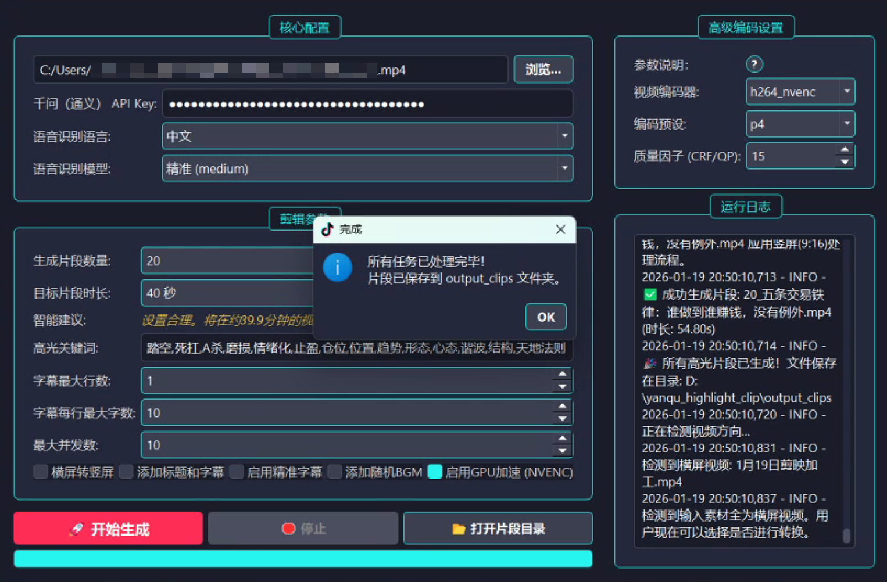
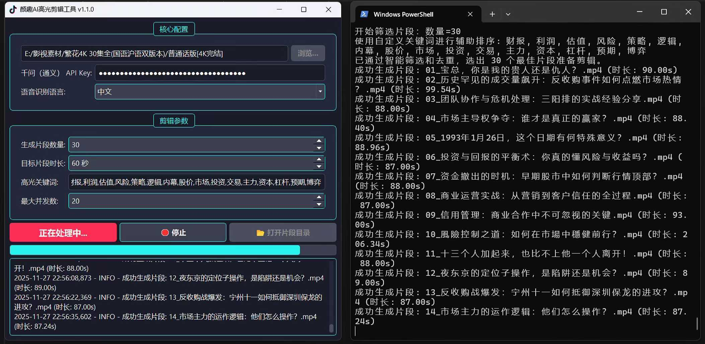

# AI Highlight Clip

[简体中文](./README.md) | [English](./README_en.md)

将长视频转化为候选高光片段的 AI 辅助剪辑工作流。

项目结合语音识别、大模型内容评分、时间轴定位、视频裁剪和字幕生成，帮助课程、访谈和直播团队更快完成长内容的初步筛选。最终选片和发布决策仍由人工完成。

## 项目背景

从数小时视频中寻找适合二次分发的片段，通常需要人工完整观看、记录时间点、剪辑并重新制作标题和字幕。该流程耗时，并且不同编辑人员的筛选标准难以保持一致。

AI Highlight Clip 将初筛过程拆分为可观察的处理步骤，并保留关键词、目标时长和片段数量等人工配置项。

## 目标用户

- 课程、访谈、播客和直播内容团队
- 需要处理大量长视频素材的运营人员
- 研究 AI 辅助视频理解与剪辑流程的开发者

## 主要能力

- **语音识别与时间轴对齐**：集成 OpenAI Whisper 模型，将视频语音精准转写为带时间戳的字幕文本，支持多语言识别，可按精度与硬件条件选择不同规模的模型
- **滑动窗口无遗漏扫描**：通过滑动窗口切片算法遍历完整时间轴，确保长视频中任意位置的候选片段都会进入评分环节，不会因分段边界而漏掉内容
- **LLM 内容评分**：利用大语言模型理解转录文本的上下文，结合用户提示词与自定义关键词，为每个候选片段给出"高光指数"评分
- **候选片段筛选**：按 AI 评分、关键词密度和内容重叠度三个维度综合排序，自动筛选 TOP N 片段并剔除内容雷同的候选，避免产出重复
- **标题草稿生成（人工终审）**：为每个入选片段生成符合内容主题的标题草稿，作为人工编辑的起点，最终标题由编辑人员确认后使用
- **字幕断句与排版优化**：使用 FFmpeg 裁剪片段并合并字幕；内置断句排版优化算法，改善字幕的换行位置与阅读节奏，支持自定义字体
- **批量处理与桌面界面**：支持单文件或整个目录（如整套课程、连续剧）批量输入，在 PyQt5 界面中展示任务进度与实时日志，输出目录一键打开

## 📸 软件截图

<p align="center">
  
  <br>
  <em>软件主界面：参数配置、任务进度与日志集中在同一窗口。</em>
</p>
<p align="center">
  
  <br>
  <em>批量处理示例：将 30 集 4K 剧集（约 44GB 素材）初筛为 30 个指定主题的候选高光片段。</em>
</p>

## 工作流

```text
Long-form video
    -> Speech transcription
    -> Time-aligned transcript
    -> Sliding-window segmentation
    -> LLM-assisted scoring
    -> Candidate ranking and de-duplication
    -> FFmpeg clipping and subtitle rendering
    -> Human review and export
```

## 技术设计

- `LLMClient`：模型调用和结构化结果处理，输出经 Pydantic 校验，评分失败时可安全降级
- `SubtitleService`：语音识别与字幕处理，负责 Whisper 转写、时间轴对齐和断句排版优化
- `AIPipeline`：评分、标题和剪辑流程编排，串联滑动窗口切片、候选排序与重复候选剔除逻辑
- `Processor`：媒体文件处理，封装 FFmpeg 裁剪与字幕合成
- `MainWindow`：参数配置、任务状态和输出管理

主要技术：Python、OpenAI Whisper、DashScope、Pydantic、FFmpeg、PyQt5。

## 快速开始

### 环境要求

- Python 3.8+
- FFmpeg（需加入 `PATH`；Windows 仓库中包含兼容版本，macOS/Linux 请参考 [FFmpeg 官网](https://ffmpeg.org/download.html)；可用 `ffmpeg -version` 验证）
- DashScope API Key

### 安装与启动

1. 克隆仓库：

```bash
git clone https://github.com/toki-plus/ai-highlight-clip.git
cd ai-highlight-clip
```

2. 创建并激活虚拟环境（推荐）：

```bash
python -m venv venv
# Windows
venv\Scripts\activate
# macOS/Linux
source venv/bin/activate
```

3. 安装依赖：

```bash
pip install -r requirements.txt
```

> 注意：`openai-whisper` 的安装可能需要 Rust 编译环境，如遇问题请参考其官方文档。

4. 配置 API Key：在 `config.ini` 的 `api_key` 字段填入 DashScope Key，或首次运行时在界面中配置。不要将真实密钥提交到仓库。

5. 运行程序：

```bash
python yanqu_highlight_clip.py
```

使用时按界面顺序操作：配置 API Key 与识别模型 → 选择视频文件或目录 → 设定片段数量、目标时长、高光关键词与字幕选项 → 开始生成 → 在 `output_clips` 目录获取候选片段并人工终审。

## 使用边界

- 模型评分只能作为初筛建议，不能替代人工内容判断；标题草稿需人工终审后使用。
- 输出质量受录音质量、语言、模型和提示词影响。
- 处理长视频时需要较多计算资源和磁盘空间。
- 当前版本尚未建立完整的自动化测试与 CI。

## 项目价值

本项目验证了"非结构化长视频 → 结构化文本 → 候选片段 → 人工确认"的端到端方案，而不是完全自动替代编辑人员。滑动窗口扫描、三维筛选排序与字幕排版优化等环节，体现了将 AI 能力嵌入既有剪辑流程时的工程设计取舍。

## 📂 更多项目

- [video-mover](https://github.com/toki-plus/video-mover) — 多平台内容分发自动化流水线：素材处理、文案生成、定时调度与多平台适配
- [ai-ttv-workflow](https://github.com/toki-plus/ai-ttv-workflow) — 文案到短视频的桌面工作流，关键节点保留人工确认
- [ai-video-workflow](https://github.com/toki-plus/ai-video-workflow) — 多模型 AIGC 视频生成流水线：文生图、图生视频、文生音乐的异步编排
- [ai-mixed-cut](https://github.com/toki-plus/ai-mixed-cut) — 素材库结构化与脚本重组的视频再创作工作流
- [ai-trader-for-mt4](https://github.com/toki-plus/ai-trader-for-mt4) — LLM×MT4 受控执行框架：工具约束、风控规则、状态管理与异步桥接
- [ai-trader-for-mt5](https://github.com/toki-plus/ai-trader-for-mt5) — 面向 MT5 的 AI 交易助手与 EA 工程化框架
- [auto-usps-tracker](https://github.com/toki-plus/auto-usps-tracker) — 跨境电商批量物流追踪与 Excel 报告自动化
- [AB-Video-Deduplicator](https://github.com/toki-plus/AB-Video-Deduplicator) — 基于高帧率抽帧混合的视频再创作实验工具
- [netease-downloader](https://github.com/toki-plus/netease-downloader) — 网易云音乐下载桌面应用：扫码登录、下载队列、ID3 元数据写入

## License

See [LICENSE](./LICENSE).
